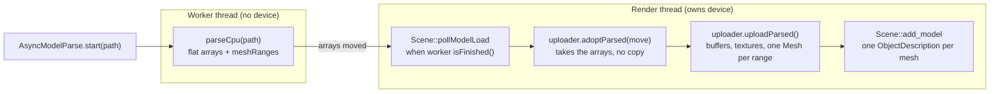

# Model loading

How a model file becomes drawable geometry in the Vulkan engine: the one
loader, the async parse/upload split that keeps the frame loop responsive, and
the multi-mesh flow that turns one file into per-mesh draws. The chronological
change log is `docs/source/cpp-renderer-improvements.md`.

## One loader for every format

`GltfLoader` (`scene/GltfLoader.{ixx,cpp}`) loads `.gltf`, `.glb` and `.obj`
into one set of CPU-side arrays; the bridge picks OxidANT's glTF or OBJ reader
by the file's extension. It exposes:

- `parseCpu(path)` — reads and decodes the file into flat arrays
  (`vertices`, `indices`, per-triangle `materialIndex`, `materials`, plus a
  per-mesh `meshRanges` table, see below). Touches **no Vulkan**, so it can run
  on any thread.
- `uploadParsed()` — builds the Vulkan-side `Model` (buffers, textures, meshes)
  from the last `parseCpu` result. **Must** run on the thread that owns the
  device.
- `adoptParsed(other&&)` — moves another loader's parse results in, so a
  device-owning loader uploads what a device-free worker produced without
  copying the (tens-of-MB) arrays.

`loadModel(path)`, the synchronous path, is `parseCpu` then `uploadParsed`
back-to-back on the calling (device-owning) thread.

### The OBJ reader

An `.obj` goes through the same bridge call to OxidANT's OBJ reader
(`kataglyphis_assets::obj::load_obj_flat`), the one the WebGPU renderer opens
OBJ through too. It is tolerant like tinyobjloader, which it replaced on
2026-11-23: a malformed or unsupported line is skipped and logged, a number
that does not parse or is not finite reads 0, relative indices resolve, a face
over 2048 corners is skipped, and only a file without a drawable face fails.
Polygons split as tinyobjloader split them (a quad along its shorter diagonal,
larger ones through its ear clipper). Each `usemtl` run is one `MeshRange`: a
run ends where its `o`/`g` group or its material does (owner 2026-11-24), so
Sponza draws 385 meshes (`ObjLoader` drew 373, one per group). The `.mtl`
files and textures are confined to the OBJ's folder like a glTF's buffers and
images (owner 2026-11-24). Textures arrive decoded, as glTF's do (below); a
file that cannot be read or lies outside the folder leaves its slot at -1. Tangents are
the glTF path's, generated from UV0 per run. The material rules are the
owner's (2026-11-19): `d` below 1 or `Tr` above 0 is BLEND, a `map_Ke`
without any `Ke` glows at factor 1 (an authored `Ke 0 0 0` stays dark), no
`Kd` is white, no `Pr` and no `Ns` is roughness 1, `map_d` is its own linear
mask slot cut at 0.5.
`ObjLoaderDiff` compared tinyobjloader's `ObjLoader` with the bridged reader
on every fixture and fetched OBJ scene before the switch
([`cpp-renderer-improvements.md`](cpp-renderer-improvements.md)).

### The glTF parser

`GltfLoader::parseCpu` is OxidANT's loader, the one the WebGPU renderer uses,
called over the cxx bridge (`load_gltf_flat` in `crates/cxx_bridge/src/gltf.rs`,
flattened by `crates/assets/src/flat.rs`). `GltfLoaderRust.cpp` keeps the
returned `GltfModel` alive through an untyped `std::shared_ptr` and views its
vertices, indices, material ids and texture chains in place (`std::span` over
`data()`/`size()`; `GltfVertex` and `Vertex` agree field by field): nothing is
copied before the staging buffer, which for `Colosseum-gltf` was about 0.5 GB
held twice at the parse's peak. Copies of a loader share the parse. It bakes the default morph pose (the node's
`weights`, else the mesh's) and world space, reverses a mirrored node's winding,
gives a primitive without `NORMAL` one vertex per corner with its face's
normal, keeps only the vertices a primitive's indices use, and hands textures
over decoded, deduped on `(image sources, sampler settings, srgb)`.

**`EXT_meshopt_compression` views are decoded before an accessor reads them**
(`crates/assets/src/meshopt.rs`, plan N4): gltfpack's `-c` and `-cc` output
loads, in both renderers. Each compressed bufferView's stream is decoded in safe
Rust (`meshopt_codec.rs`: the attribute codec's version 0, the triangle and index
codecs, the octahedral, quaternion and exponential filters, as meshoptimizer's
scalar decoder does) in place into the parent view's range: of its fallback
buffer, which is never read, of a URI-less placeholder, or of a buffer with data.
A view that breaks the extension's layout rules, a stream that ends early or runs
on, and a placeholder declaring more than its views decode (each rounded up to 16
bytes) fail the load. One file's views decode to at most 1 GiB.
`KHR_meshopt_compression` (gltfpack's `-cz`, the attribute codec's version 1 and
the colour filter) is not read.

**Textures are decoded in Rust, on every core of the parse thread** (plan B5).
Each slot is a mip chain, level 0 first and packed back to back (`levels.rs`'s
`TextureChain`, tagged with its `ChainFormat`), which `Texture::createFromLevels`
uploads without a blit. PNG, JPEG, BMP, TGA, GIF, PNM, Radiance HDR and WebP (lossy or
lossless) decode through the image crate (`image_decode.rs`, channels expanded and HDR gamma-encoded
as stb's `STBI_rgb_alpha` does) to a full RGBA8 chain down to 1x1, box-filtered with
the WebGPU renderer's filter (sRGB averaged in linear space). A `KHR_texture_basisu`
KTX2 is preferred over the core `source`, then an `EXT_texture_webp` image; one that
does not decode falls back to the next, the core `source` last. **A KTX2 arrives as the
blocks the device samples** (plan B5 step 3): `VulkanDevice` enables `textureCompressionBC`, `ETC2` and
`ASTC_LDR` where offered and counts a family (`BlockSupport`, `scene/TextureFit.hpp`)
when every one of its formats, in both colour spaces, samples, filters linearly and
takes a copy with optimal tiling; the renderer hands that and `maxImageDimension2D`
to the scene before its first load, and the options carry them to the bridge. A Basis
payload is transcoded once to BC7, else ETC2, else ASTC 4x4, a BCn KTX2 kept as stored,
when the base is whole 4x4 blocks and a level of whole blocks fits the side; the chain
keeps the file's levels, and a colour slot samples the sRGB format (BC5 has none).
Otherwise the payload is transcoded straight to RGBA8 or decoded, and a chain shorter
than full is completed by halving its last level. A stored ETC2 or ASTC KTX2 is still
refused; the core `source` is the fallback whenever the KTX2 fails. PSD and PIC arrive
as the file's bytes with
`levelCount` 0 for `Texture::createFromMemory`'s stb. An image over 16384x16384
pixels (`MAX_PIXELS`, read from its header, PSD and PIC included) or in no format
either reader knows gets no slot, and the materials' ids are renumbered. Decodes in
flight share a 1 GiB budget, and one image under two samplers is decoded once. A
level over `maxImageDimension2D` is skipped (a block chain starts at whole blocks);
a chain none of whose levels fits gets the default texture, as does a block format the
device does not sample. `Colosseum-gltf`'s 69 PNG and JPEG images make 760 MB of RGBA8
chains, held until `uploadParsed` has staged them; the decode runs after the scene walk
with the document's buffers already dropped, so `load_flat` peaks at 1.28-1.30 GiB
resident there (745 MiB when it handed over the encoded files). The same images as
UASTC KTX2, AssetANT's `Colosseum-ktx2`, make 190 MB of BC7 chains on a BC device
instead of 760 MB of RGBA8: `load_flat` peaks at 706-714 MiB instead of 1349-1375 MiB,
and the textures take 190 MiB of device memory instead of 760 MiB. The document, its buffers and
its images must be regular files, the buffers and images inside the document's
directory.

What a load asks beyond the file is a `GltfLoadOptions` (`mikktspaceTangents`
and the device's `blocks`), which `parseCpu`, `loadModel`, `AsyncModelParse::start`
and `Scene` hand to `load_gltf_flat_with`; each field's zero is the loader's default,
RGBA8 for every texture. The
loader reads no environment: `App::run` turns `KATAGLYPHIS_MIKKTSPACE_TANGENTS`
into the options once, through `gltfLoadOptionsFromEnvironment` (any non-empty
value; empty counts as unset, as in OxidANT's viewer), and tests ask through the
options. The fixtures both renderers load are OxidANT's
`crates/assets/tests/assets`; `GltfFixtureRoundTrip.*` checks each one's
mapping into `Vertex`, `MeshRange` and `ObjMaterial`. What the parser decides
(slots, material defaults, the scene walk) is tested in OxidANT's
`crates/assets/tests/flat.rs`; `GltfParseUnit.*` keeps what the C++ side decides.

An error, or a panic in any build, comes back as a failed parse, never an
exception or an abort: every bridged call runs inside OxidANT's `guarded()`,
and the non-Debug builds link the bridge with OxidANT's `bridge` cargo profile
(`Src/CMakeLists.txt`), release with `panic = "unwind"`, since the release
profile's abort let a loader panic end the engine. The path crosses as UTF-8
(`Shared::utf8PathBytes`): a Windows `std::string` is ANSI, which the bridge
rejects. The loader's warnings come back as values too: right after the call,
on the thread that made it (the parse worker), `logOxidantRecords` drains
OxidANT's `take_log_records()` into spdlog.

It walks a single scene, not every node in the document: the default scene if
the document names one, else the first of `scenes` (`walk_nodes` in
`crates/assets/src/gltf_loader.rs`). Only nodes reachable from that scene's
roots are loaded. A document with no `scenes` array at all falls back to every
node, with a warning, since that is the only geometry available.

Until 2026-11-18 the engine had its own cgltf parser beside this one; a
field-by-field comparison of the two on every fixture and fetched scene found
three defects in each before the Rust loader became the only one (owner
decision, [`cpp-renderer-improvements.md`](cpp-renderer-improvements.md)).
`BM_GltfLoaderParseCpu_*` times the whole parse; on `linux-profile-clang`,
8-core aarch64 WSL, `Colosseum-gltf` (206 MB of buffers) took 394 ms against
cgltf's 481 ms. That row skips unless `KATAGLYPHIS_FETCH_ALL_ASSETS` fetched
the scene.

The same walk reads each visited node's `KHR_lights_punctual` light, mesh or no mesh, posed by the
node's world transform (the Rust loader's `read_light`). The lights ride
on the `Model`, so `adoptParsed` moves them with the geometry, and the renderer places them by the
model's matrix when it packs the punctual-light buffer.

The first directional light is the Sun instead, both renderers' rule (OxidANT's `CpuScene::take_sun`):
it leaves the lights, rides on the `Model` as `getSun()`, and the load's `RendererFeedback::publishedSun`
hands its direction and colour to the editor's Sun in `applyRendererFeedback`. The radiance stays the
editor's, since glTF gives lux. A direction its node scales to nothing is no Sun and no light either.

## The async parse/upload split

The parse is device-free and dominates load time (2802 ms of a 2818 ms load on
the bundled 27 MB `dinosaurs.obj`), so it runs off the render thread:

1. `AsyncModelParse` (`scene/AsyncModelParse.ixx`) runs `parseCpu` on a worker
   thread against a fresh device-free `GltfLoader{}`.
2. When the worker finishes, `Scene::pollModelLoad` (`scene/Scene.cpp`) hands
   the worker's loader to a **device-owning** uploader via `adoptParsed` and
   calls `uploadParsed`, the only ~15 ms the frame loop pays.

So `adoptParsed` must move every field `uploadParsed` reads, `meshRanges`
included; miss one and the async path silently loads different geometry than
the synchronous one.



## One file, many meshes

A `Model` holds `std::vector<Mesh>` (`scene/Model.ixx`). One file becomes a
multi-mesh model through a per-mesh **`MeshRange`**, a slice of the flat arrays:

```
struct MeshRange {
    vertexBase, vertexCount, indexStart, indexCount, triStart, triCount, doubleSided, alphaBlended
};
```

`doubleSided` carries glTF `material.doubleSided` per range, so `uploadParsed`
hands it to `add_new_mesh` and the raster pass can disable back-face culling
for that mesh alone. `alphaBlended` carries `alphaMode` `BLEND` the same way
(`Mesh::isAlphaBlended`): the opaque forward and deferred draws skip the mesh,
and `collectBlendDraws` (`renderer/MeshDrawRecorder.cpp`) draws it after them,
farthest first by the squared distance from the eye to its world-bounds centre,
through `buildTransparentScenePipeline` (src-alpha blending that accumulates
coverage, depth test on, depth writes off). Deferred shades it forward after
the lighting pass, against the geometry pass's depth. An OBJ is never
double-sided; its `d` below 1 or `Tr` above 0 blends.

The type lives in its own module, `kataglyphis.vulkan.mesh_range`
(`scene/MeshRange.ixx`), `export import`ed by `GltfLoader`. It exports
`MeshRange` and the two pieces the upload uses: `meshRangeFits`, which decides
whether a range gets its mesh or an empty one, and `rebaseIndices`.

`parseCpu` records one range per sub-object and keeps the flat arrays intact
(the `ObjParseUnit`/`GltfParseUnit` tests assert on the flat getters);
`GltfLoader::uploadParsed` hands `add_new_mesh` subspans of the bridge's arrays
(`addMeshesForRangesInPlace`), and `Mesh` re-bases the indices while it writes
them into the staging memory. A sub-object is:

- **glTF** — one **primitive**. Primitives already parse into disjoint
  contiguous vertex ranges, so the range is recorded directly.
- **OBJ** — one **`usemtl` run**, ended by its `o`/`g` group or its
  material; the range gets only the vertices its triangles use, so a vertex
  two runs share is stored once per run.

A single-primitive glTF or single-run OBJ yields exactly one range
spanning everything.

## What downstream gets for free

Object identity is per **mesh**, not per model, so splitting a file into
meshes feeds the systems that were already mesh-aware:

- **Object descriptions** — `Scene::add_model` flattens one `ObjectDescription`
  per mesh; `objectIndex` is the flat mesh index (sum of prior models' mesh
  counts + local index), pushed per draw in the forward/deferred/shadow record
  loops.
- **Culling** — the record loops iterate meshes with per-mesh AABBs, so a
  multi-mesh model culls per mesh instead of all-or-nothing.
- **Acceleration structures** — one BLAS per model with one **geometry** per
  mesh; RT/PT kernels fetch the per-mesh material with
  `instanceCustomIndex (= the model's first-mesh flat index) + gl_GeometryIndexEXT`
  (`GoldenRender.TracedSecondModelResolvesItsOwnMeshAndTextures`). An `addModel`
  or a finished load builds only the new model's BLAS: a BLAS stays while the
  scene holds the model object it was built from at its index (`BlasReuse.hpp`),
  so a reload rebuilds; every scene change rebuilds the TLAS
  (`GoldenRender.AddedModelBuildsOnlyItsOwnBlas`).

## Material fields and where they come from

`ObjMaterial` (`Src/shared/scene/ObjMaterial.hpp`) is the single struct both
loaders fill and every shader reads. OxidANT's `load_material`
(`crates/assets/src/gltf_loader.rs`), flattened by `flat.rs` and copied by
`toObjMaterial` (`GltfLoaderRust.cpp`), is the glTF mapping; OxidANT's `obj/flat.rs` and `obj/material.rs` are the `.mtl` mapping, which writes `roughness` itself.
A `—` means that format has no source for the field, so the struct keeps its
default (documented on the member in `ObjMaterial.hpp`). "Read by" names the
shading paths at a glance; the exact per-path expression, or "not read" and
why, is in
[`shader-sharing.md`'s "Which C++ shading path reads which `ObjMaterial`
field"](shader-sharing.md#which-c-shading-path-reads-which-objmaterial-field).

| Member | glTF source | `.mtl` source | Read by |
| --- | --- | --- | --- |
| `diffuse` | `pbrMetallicRoughness.baseColorFactor.rgb`; glTF's default `(1, 1, 1)` if the material has no `pbrMetallicRoughness` block, and for the no-material fallback (owner decision 2026-11-17) | `Kd`; white without it (owner 2026-11-19) | `rasterizer.slang`, `deferred.slang`, `raytrace.rchit.slang`, `path_tracing.slang` (untextured fallback / `base_color()` blend) |
| `emission` | `emissiveFactor`, scaled by `KHR_materials_emissive_strength` when present (`1.0` otherwise) | `Ke`; `(1, 1, 1)` for a `map_Ke` without any `Ke` | all four shading paths, via `common/emission.slang`'s `material_emission()` |
| `shininess` | — (pinned to `1.0`, the OBJ-only fallback `roughness_factor()` falls back to; glTF's `roughness_factor` is not read here) | — (pinned to `1.0`; the reader folds `Ns` into `roughness`) | `material_rules.slang`'s `roughness_factor()`, OBJ materials only |
| `dissolve` | `baseColorFactor.a` | `d` | `material_rules.slang`'s `material_masked_out()` and, for BLEND, `blend_coverage()` |
| `textureID` | dedup'd slot into `getTextures()` (`flat.rs`'s `Slots`, keyed on `(image sources, sampler settings, srgb)`) | dedup'd slot into `getTextures()` (`obj/flat.rs`'s `Slots`, keyed on `(canonical file, srgb)`); `-1` without `map_Kd` or with an unreadable file | all five entry points, via `texture_offset + material.textureID` (see below) |
| `sampler` (not an `ObjMaterial` field — tracked separately, index-parallel with `getTextures()`, via `GltfLoader::getTextureSamplerDescs()`) | `textures[].sampler`'s wrap modes and mag/min/mipmap filters, mapped to `GltfSamplerDesc` (`vulkan_base/SamplerBuilder.ixx`) | — (OBJ has no sampler concept; every OBJ texture keeps the repeat/linear/linear default) | `Model::addSampler`, when building the texture's `vk::Sampler` |
| `srgb` (not an `ObjMaterial` field — tracked separately, index-parallel with `getTextures()`, via `GltfLoader::getTextureSrgbFlags()`) | `true` for base-colour/emissive views, `false` for the normal and metallic-roughness views | `true` for `map_Kd`/`map_Ke`, `false` for `norm`/`map_Bump`/`map_d` | `Texture::createFromLevels`/`createFromMemory`/`createFromFile`, selecting `eR8G8B8A8Srgb` vs. `eR8G8B8A8Unorm` |
| `alphaCutoff` | `material.alpha_cutoff` when `alphaMode == MASK`, else `-1` (never read then: `alphaMode` decides) | `0.5` with `map_d`, else `-1` | `material_rules.slang`'s `material_masked_out()` |
| `uv_transform_row0` / `uv_transform_row1` | `KHR_texture_transform`'s T\*R\*S rows on the base-colour texture (the extension is per-slot — see the normal/metallic-roughness/emissive row pairs below for the other three); identity rows if the extension is absent on this slot | — | `base_color.slang`'s `base_color_uv()` |
| `metallic` | `pbrMetallicRoughness.metallicFactor`, clamped `[0,1]`; glTF's default `1` without the block and for the no-material fallback | `Pm`, else `0` | `rasterizer.slang`/`raytrace.rchit.slang` (`f0`, `brdf_direct`), `deferred.slang` (G-buffer normal's `.a`), `path_tracing.slang` (`f0` and `brdf_direct`, for NEE and the sampled lobes) |
| `roughness` | `pbrMetallicRoughness.roughnessFactor`, clamped `[0,1]`; glTF's default `1` without the block and for the no-material fallback, so a glTF material never reaches the `-1` ("unauthored") sentinel | `Pr`; without it `Ns` through `sqrt(2/(Ns+2))`, clamped `[0.045, 1]`; without either `1` | `material_rules.slang`'s `roughness_factor()`, then `gltf_material.slang`'s `material_roughness()` |
| `emissiveTextureID` | dedup'd slot into `getTextures()` (same `Slots` key as `textureID` — an emissive view with the same image and sampler settings as the base-colour view lands on the same slot); `-1` if the material has no `emissiveTexture` | dedup'd slot (same `Slots` as `textureID`, sRGB); `-1` without `map_Ke` | all four shading paths, via `common/emission.slang`'s `material_emission()` |
| `normalTextureID` | dedup'd slot into `getTextures()` (same `Slots` key as `textureID`/`emissiveTextureID`); `-1` if the material has no `normalTexture` | dedup'd slot (same `Slots`, linear); `norm` preferred over `map_Bump`/`map_bump`/`bump`; `-1` without either | all four shading paths, via OxidANT's `common/gltf_material.slang` (`tangent_space_normal()`, `apply_normal_map()`), using `Vertex::tangent` for the TBN basis |
| `normalScale` | `normalTexture.scale`; `1.0` if the material has no `normalTexture` | the winning normal-directive's own `-bm` option (`norm`'s if present, else `map_Bump`/`map_bump`/`bump`'s); `1.0` if neither directive is present | `gltf_material.slang`'s `tangent_space_normal()` |
| `metallicRoughnessTextureID` | dedup'd slot into `getTextures()` (same `Slots` key as `textureID`/`emissiveTextureID`/`normalTextureID`), uploaded linear; `-1` if the material has no `pbrMetallicRoughness` block or no `metallicRoughnessTexture` | — | `material_rules.slang`'s `material_metallic_roughness()` in all four shading paths; `path_tracing.slang` uses the metallic (`.x`) half only, having no roughness term |
| `normal_uv_transform_row0` / `_row1` | `KHR_texture_transform`'s T\*R\*S rows on the `normalTexture`; identity rows if the extension is absent on this slot | — | the normal sample in all four shading paths, via `base_color.slang`'s `normal_uv()` |
| `metallic_roughness_uv_transform_row0` / `_row1` | `KHR_texture_transform`'s T\*R\*S rows on `pbrMetallicRoughness.metallicRoughnessTexture`; identity rows if the extension is absent on this slot | — | the metallic-roughness sample in all four shading paths, via `base_color.slang`'s `metallic_roughness_uv()` |
| `emissive_uv_transform_row0` / `_row1` | `KHR_texture_transform`'s T\*R\*S rows on `emissiveTexture`; identity rows if the extension is absent on this slot | — | the emissive sample in all four shading paths, via `base_color.slang`'s `emissive_uv()` |
| `unlit` | `1` if the material declares `KHR_materials_unlit`, else `0` | — (`.mtl` has no unlit concept) | all four shading paths return the base colour unshaded when set: `rasterizer.slang`/`raytrace.rchit.slang` return early, `deferred.slang` carries it as OxidANT's `gbuffer.slang` packs it, a metallic of -1, `path_tracing.slang` terminates the path at the hit |
| `alphaTextureID` | — (glTF carries opacity in `baseColorTexture.a`, not a separate texture slot) | dedup'd slot (same `Slots`, linear); `-1` without `map_d` | `rasterizer.slang`, `deferred.slang`, `shadow_map.slang`, `common/alpha_test.slang`, sampled `.r` at the base-colour UV and folded into the alpha `material_rules.slang`'s `material_masked_out()` tests |
| `uv1SlotMask` | bit per slot (0 base colour, 1 metallic-roughness, 2 normal, 3 emissive, 4 occlusion) whose `texCoord` is 1; `KHR_texture_transform`'s `texCoord` overrides the textureInfo's; TEXCOORD_2+ warns and stays on 0 | — (`0`: the OBJ reader copies UV0 into `texture_coords1`, so either set samples the same) | every texture sample, via `base_color.slang`'s `slot_uv()`; `map_d` follows the base-colour bit |
| `alphaMode` | `alphaMode`'s `alpha_mode.slang` code (`ALPHA_OPAQUE`, `ALPHA_MASK`, `ALPHA_BLEND`), across the bridge as `GltfMaterial::alpha_mode` | `ALPHA_MASK` with `map_d`; else `ALPHA_BLEND` when `d` is below 1 or `Tr` above 0; else `ALPHA_OPAQUE` | `material_rules.slang`'s `material_masked_out()` (MASK) and `blend_coverage()` (BLEND, the forward shader's output alpha), `shadow_map.slang` and `alpha_test.slang`'s MASK guard, `BlasGeometryLimits.hpp`'s any-hit flag; the tracers render BLEND opaque |
| `occlusionTextureID` | dedup'd slot into `getTextures()` (same `Slots` key, linear, so an ORM image shares the metallic-roughness slot); `-1` if the material has no `occlusionTexture` | — (`-1`: `.mtl` has no occlusion map) | `material_textures.slang`'s `resolved_occlusion()` in `rasterizer.slang`, `deferred.slang` (into the G-buffer's albedo alpha) and `raytrace.rchit.slang`; it scales the ambient term only |
| `occlusionStrength` | `occlusionTexture.strength`; `1.0` if the material has none | `1.0` | `resolved_occlusion()`, through OxidANT's `material_occlusion()`: `lerp(1, texel.r, strength)` |
| `occlusion_uv_transform_row0` / `_row1` | `KHR_texture_transform`'s T\*R\*S rows on `occlusionTexture`; identity rows if the extension is absent on this slot | identity | `base_color.slang`'s `occlusion_uv()` |

## Textures, samplers and the 128-slot budget

<!-- max-texture-count: 128 -->

Every texture from every loaded model lands in one flat, fixed-size global
array bound at `TEXTURES_BINDING`/`SAMPLER_BINDING`, sized by
`Resources/ShadersSlang/common/shared_constants.slang`'s `MAX_TEXTURE_COUNT`, which
`common/host_device_shared_vars.hpp` includes: `static const int MAX_TEXTURE_COUNT = 128;`. The loader economises against that
budget:

- **glTF dedup by image, sampler settings and colour space** —
  OxidANT's `flat.rs` (`Slots`) keys each slot on the triple
  `(image, sampler settings, srgb)`, not the material
  or the texture slot (base-colour vs. emissive vs. normal). One
  decode+upload per triple, however many materials or texture slots reference
  it: a material whose base-colour and emissive views name the same PNG shares
  one slot (`textureID == emissiveTextureID`), and so do two equal sampler
  objects. Two textures that share an image but sample it differently, or need
  different colour spaces, still get
  distinct slots; collapsing them would make the second texture's wrap/filter
  settings unobservable, or upload one of the two through the wrong
  `VkFormat`. A base-colour/normal pair sharing one image therefore gets
  **two** slots, one uploaded sRGB (`Texture.cpp`'s `uploadRgba` picks
  `eR8G8B8A8Srgb`), the other UNORM (`eR8G8B8A8Unorm`): glTF normal maps are
  linear tangent-space data, not gamma-encoded colour.
- **OBJ dedup by file and colour space** — OxidANT's `obj/flat.rs` (`Slots`)
  keys on the resolved file's canonical path and the sRGB flag, so two
  materials naming one file through different `.mtl` spellings (`tex.png` vs
  `./tex.png`) share a slot, and a file used as colour and as a normal map
  gets two. A file that cannot be read gets no slot (-1).
- **A corrupt image gets no slot** — OxidANT drops a slot whose image does not
  decode and renumbers the materials' later ids (`flat::renumber_slots`;
  `GltfParseUnit.ACorruptImageGetsNoSlotAndLaterIdsAreRenumbered`).
- **A failed upload still occupies its slot** — when `Texture::createFromLevels`
  or `createFromMemory` fails, `GltfLoader::uploadParsed`'s `addTextureOrDefault` call substitutes
  the default texture instead of skipping the slot, so every later
  `textureID` keeps its meaning.
- **Sampler dedup by mip level and glTF sampler description** —
  `Model::addSampler` (`scene/Model.cpp`) keys on a
  `SamplerKey{ mipLevel, GltfSamplerDesc }` via `findSampler`
  (`vulkan_base/SamplerBuilder.cpp`): N textures share one `vk::Sampler` only
  when both their mip count and their wrap/filter settings match.
- **Flattening into the global array** — `assignTextureOffsets`
  (`scene/ObjectDescription.ixx`) stamps each mesh's `texture_offset` with its
  model's running offset into the flattened array, advancing by that model's
  texture count once its meshes are done; `planFlattenedTextureSlots` (same
  module) is the mirror image that builds the array, in model order, capped at
  `MAX_TEXTURE_COUNT` and padded with slot 0 past the cap. All five entry
  points (`rasterizer`, `deferred`, `shadow_map`, `path_tracing`,
  `raytrace.rchit`) compute and clamp `textureId` the same way,
  `clamp(int(obj.texture_offset) + material.textureID, 0, MAX_TEXTURE_COUNT - 1)`,
  so a model that pushes the total past budget samples a wrong (but in-bounds)
  slot instead of reading out of the descriptor array.

Both readers fill `Vertex::texture_coords1`, the second UV set (vertex
attribute location 5): the glTF loader reads `TEXCOORD_1` and copies
TEXCOORD_0 where a primitive has none;
the OBJ reader always copies. When a glTF primitive has no `TANGENT`,
the loader builds the frame from the UV set its normal texture samples.

Both readers also emit per-vertex colours (glTF `COLOR_0`; OBJ `v x y z r g b`)
and fill missing normals, differently: the glTF reader gives a primitive
without a `NORMAL` accessor one vertex per triangle corner with its face's
normal; the OBJ reader never shares a corner without a `vn` between faces, so
each such corner takes its own face's flat normal (a file with `vn` on only
some faces keeps those).

## `map_Kd` texture path resolution

OxidANT's OBJ reader resolves every texture an `.mtl` names this way, for both
renderers:

**Normalise `\` to `/` in the `map_Kd` value; resolve the result relative to
the directory containing the `.mtl` (tinyobjloader's rule, and the format's);
if that file does not exist, retry under a `textures/` subdirectory of the
same directory; if that misses too, or either path leaves the OBJ's folder,
warn and draw the material untextured (slot -1).**

- The `\`-to-`/` normalisation deliberately deviates from "as written in the
  `.mtl`": a Windows-authored relative path (`textures\wood.png`) must still
  resolve on a platform where `\` is just another filename character.
- Relative to the `.mtl` first is what the OBJ/MTL format specifies. The
  `textures/` retry exists because every textured OBJ in `Resources/Models`
  (`VikingRoom`, and the AssetANT scenes `crytek-sponza`, `Pillum` and
  `Sulo`/`WolfStahl`) keeps its textures in a `textures/` sibling directory and
  names them by bare filename, not by the format's convention.
- Every path, the `mtllib` names included, is confined like a glTF's
  (`files::confined_path`, owner 2026-11-24): no drive or scheme, no root,
  no UNC name, no `..` out of the OBJ's folder, regular files only.
- A path that resolves to neither candidate leaves the material untextured
  instead of failing the whole load, with a warning naming the file: the only
  signal a wrong or missing texture leaves.

Where: `obj::texture_source` (`crates/assets/src/obj/paths.rs` in OxidANT),
which the engine's flat model, the in-memory GLB and `obj2gltf`'s
`convert_file` all call. `convert_file` emits the path relative to the OBJ's
folder as the glTF `uri` and copies the texture to the same place beside the
glTF, never outside its folder.

## Invariants worth preserving

- `parseCpu` leaves the flat `getVertices()`/`getIndices()`/
  `getMaterialIndices()`/`getMaterials()` exactly as before the split: the CPU
  parse tests key on them, and both upload paths read from them.
- Every `MeshRange` must tile the flat arrays contiguously (no gap/overlap),
  and every index in a range must stay inside that range's own vertex block, or
  the `-vertexBase` re-base (`rebaseIndices`) corrupts the mesh. The
  `ObjParseUnit.EachUsemtlRunIsOneMeshRange`/`MultiPrimitive…RecordsPerPrimitiveMeshRanges` parse tests
  assert this at parse level, and `Test/commit/VulkanEngine/meshRangeSliceSuite.cpp`
  unit-tests `rebaseIndices` and `meshRangeFits` directly.
- Each mesh currently shares the full `materials` array (its `materialIndex`
  holds the original indices). Trimming to a per-mesh material subset would be
  an optional optimisation, which no backlog entry tracks; it would go into
  `addMeshesForRangesInPlace` in `scene/ModelAssembly.ixx`.
